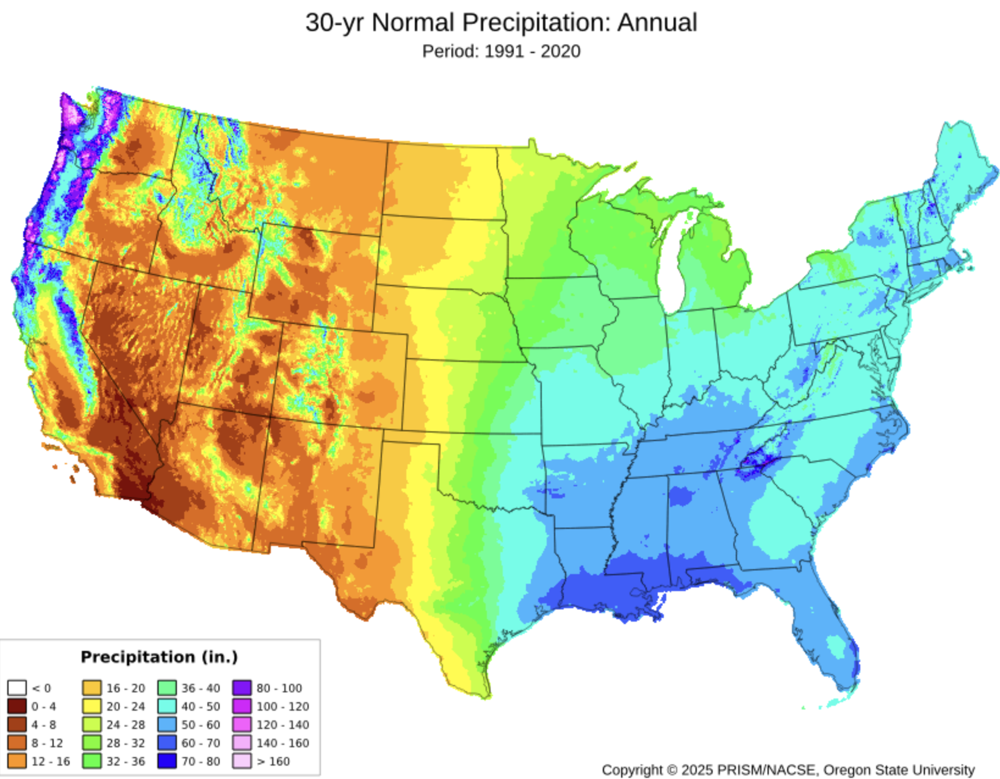

```{r}
#| eval: true
#| echo: false
#| out-width: "80%"
#| fig-align: "center"

```

::: {.callout-note icon=true}
# Overview

California spans the full spectrum of western North American climates from the foggy Pacific Coast, the Central Valley, the Sierra Nevada, and the Mojave Desert, making it an excellent case study for climate analysis with raster data.

In this review, each map algebra operation is motivated by a concrete question that a real analyst would ask:

- **Local operations:** How arid or humid is each location, and which climate zone does it fall in?
- **Focal operations:** Where are the large-scale precipitation gradients, stripped of local noise?
- **Zonal operations:** How do temperature and precipitation vary across California's climate regions?
- **Resolution matching:** What spatial detail is gained and what is the cost of using higher-resolution climate data?

**Data:** Annual mean temperature and annual total precipitation from [PRISM Climate Group](https://prism.oregonstate.edu/) at Oregon State University. PRISM data must be downloaded manually through the project's portal.
:::

***
# Pre Lab Prep{.anchored}  

## Data Download

::: {.callout-important icon=true}
### Download data

All data comes from the **PRISM Climate Group** portal. You will download three files total.
:::

### Step 1 — Navigate to the PRISM Normals page

Go to **[prism.oregonstate.edu](https://prism.oregonstate.edu/)**, click **Data Grids**, then select **1991-2020 Normals**.

### Step 2 — Download annual mean temperature (4 km)

On the Normals page:

1. Set ** Spatial Resolution** to *4km*
2. Set **Variable** to *Mean Temperature (tmean)*
3. Set **Time Step** to *Annual*
4. Download the `.zip` file, unzip it, and save it to your `data` directory for your labs repo. 


### Step 3 — Download annual total precipitation (4 km)

Repeat Step 2 but change **Variable** to *Precipitation (ppt)*:

Unzip into the same `data/` folder.

### Step 4 — Download annual total precipitation (800 m)

Repeat Step 3 but change **Resolution** to *800m*:

Unzip into `data/` as well. This higher-resolution file is used only in the [Resolution Matching](#resolution-matching) section.

---

## Metadata Review

::: {.callout-important icon=true}
### Complete this section before writing any code

Every PRISM ZIP archive includes a `.xml` file alongside the `.tif` raster. This XML contains the dataset's metadata. Open the metadata for the three different datasets you downloaded and use it to answer the questions below. Store your answers in the table below. 

**Find and record each of the following. Fill in your answers in the summary table below:**

1. **Spatial resolution** — What are the cell dimensions in degrees?

2. **Coordinate reference system** — What geographic coordinate system and datum are used?

3. **Units for temperature** — What units are temperature values reported in?

4. **Units for precipitation** — What units are precipitation values reported in?

5. **Temporal coverage** — What 30-year period do the normals represent?


| Property | PRISM 4 km (tmean) | PRISM 4 km (ppt) | PRISM 800 m (ppt) |
|---|---|---|---|
| Spatial Resolution | | | |
| Temporal coverage | | | |
| CRS | | | |
| Units | | | |
:::

---

# Setup

```{r}
#| message: false
#| warning: false
#| eval: true
library(terra)
library(tidyverse)
library(tmap)
library(kableExtra)
```

---

# Load and Inspect Data

`rast()` reads GeoTIFF files directly. Each file contains a single layer.

```{r}
#| echo: false
#| eval: true
annual_temp  <- rast(here::here("course-materials/labs/data/prism_tmean_us_25m_2020_avg_30y/prism_tmean_us_25m_2020_avg_30y.tif"))

annual_prec  <- rast(here::here("course-materials/labs/data/prism_ppt_us_25m_2020_avg_30y/prism_ppt_us_25m_2020_avg_30y.tif"))

prec_800m    <- rast(here::here("course-materials/labs/data/prism_ppt_us_30s_2020_avg_30y/prism_ppt_us_30s_2020_avg_30y.tif"))
```


```{r}
#| echo: true
#| eval: false
annual_temp  <- rast("data/prism_tmean_us_25m_2020_avg_30y/prism_tmean_us_25m_2020_avg_30y.tif")

annual_prec  <- rast("data/prism_ppt_us_25m_2020_avg_30y/prism_ppt_us_25m_2020_avg_30y.tif")

prec_800m    <- rast("data/prism_ppt_us_30s_2020_avg_30y/prism_ppt_us_30s_2020_avg_30y.tif")
```
Before doing any analysis, inspect what you loaded:

```{r}
#| results: hold
cat("=== Annual Temperature ===\n")
cat("Resolution:", res(annual_temp), "\n")
cat("Extent:    "); print(ext(annual_temp))

cat("\n=== Annual Precipitation (4 km) ===\n")
cat("Resolution:", res(annual_prec), "\n")
cat("Extent:    "); print(ext(annual_prec))

cat("\n=== Annual Precipitation (800 m) ===\n")
cat("Resolution:", res(prec_800m), "\n")
cat("Extent:    "); print(ext(prec_800m))

cat("\n=== Same CRS? ===\n")
cat("temp vs prec 4km: ", same.crs(annual_temp, annual_prec), "\n")
cat("4km vs 800m prec: ", same.crs(annual_prec, prec_800m), "\n")
```

## Crop to California

PRISM normals cover the entire contiguous United States. We crop all three rasters to California's bounding box before any analysis:

**How can you determine the coordinates for a bounding box? A few reliable options:**

- **[bboxfinder.com](http://bboxfinder.com)** — draw a rectangle on a map and copy the coordinates directly
- **[boundingbox.klokantech.com](https://boundingbox.klokantech.com/)** — search by place name, adjust the box, and export in several formats including decimal degrees (CSV Raw Option)
- **Google Maps** — right-click any point to copy its latitude/longitude
- **Other data you are using** — if you already have a spatial object covering your area of interest, `ext()` returns its bounding box


```{r}
ca_ext <- ext(-124.4820030034, -114.13078174, 32.5295238201, 42.0094992115)

annual_temp_ca <- crop(annual_temp, ca_ext)
annual_prec_ca <- crop(annual_prec, ca_ext)
prec_800m_ca   <- crop(prec_800m,   ca_ext)
```

Did changing the extent change our resolution at all? Let's check: 

```{r}
#| results: hold
cat("\n=== Resolution comparison ===\n")
cat("US Precip Resolution:", res(annual_prec), "\n")
cat("CA Precip Resolution:", res(annual_prec_ca), "\n")

cat("US Temp Resolution:", res(annual_temp), "\n")
cat("CA Temp Resolution:", res(annual_temp_ca), "\n")

cat("US Precip High Resolution:", res(prec_800m), "\n")
cat("CA Precip High Resolution:", res(prec_800m_ca), "\n")

```

Nope! Changing the extent of our raster **does not** change the resolution. What does it change? 

```{r}
#| results: hold
cat("\n=== Dimension comparison ===\n")
cat("US Precip Dimensions:", dim(annual_prec), "\n")
cat("CA Precip Dimensions:", dim(annual_prec_ca), "\n")

cat("US Temp Dimensions:", dim(annual_temp), "\n")
cat("CA Temp Dimensions:", dim(annual_temp_ca), "\n")

cat("US Precip High Dimensions:", dim(prec_800m), "\n")
cat("CA Precip High Dimensions:", dim(prec_800m_ca), "\n")
```

A quick look at what we're working with:

```{r}
#| message: false

map1 <- tm_shape(annual_temp_ca) +
  tm_raster(col.legend = tm_legend("Mean Annual\nTemp (°C)",
                                    position = tm_pos_out("right", "center"))) +
  tm_title("Mean Annual Temperature")

map2 <- tm_shape(annual_prec_ca) +
  tm_raster(
    col.legend = tm_legend("Annual\nPrecip (mm)",
                            position = tm_pos_out("right", "center")),
    col.scale  = tm_scale_continuous(values = "brewer.yl_gn_bu")
  ) +
  tm_title("Annual Total Precipitation")

tmap_arrange(map1, map2, nrow = 1)
```

---

# Map Algebra

## Local Operations

Local operations are computed on each cell individually, either by transforming a single layer or combining multiple layers into one. No information from neighboring cells is used.

### Computing a derived index with `lapp()`

**Question:** How arid or humid is each location, combining temperature and precipitation into a single metric?

`lapp()` applies a function using *multiple raster layers as named arguments*. Here we compute the **de Martonne Aridity Index**:

$$AI = \frac{P}{T + 10}$$

where $P$ is annual precipitation (mm) and $T$ is mean annual temperature (°C). Higher values indicate a more humid climate. The constant 10 prevents division by zero and keeps the index meaningful at sub-zero temperatures.

A single aridity metric captures the moisture balance that governs ecosystem type far better than either variable alone. It appears in drought monitoring systems, desertification risk mapping, and global biome classification.

```{r}
climate_stack <- c(annual_prec_ca, annual_temp_ca)

aridity <- lapp(climate_stack, fun = function(p, t) p / (t + 10))
names(aridity) <- "aridity"
```

```{r}
tm_shape(aridity) +
  tm_raster(
    col.legend = tm_legend("Aridity Index\n(mm / °C)",
                            position = tm_pos_out("right", "center")),
    col.scale  = tm_scale_continuous(values = "brewer.yl_gn_bu")
  ) +
  tm_title("De Martonne Aridity Index")
```

### Reclassifying into discrete zones with `classify()`

**Question:** Which broad climate zone does each cell belong to?

The aridity index is a continuous surface. `classify()` bins it into discrete categories using a reclassification matrix, converting continuous values into a categorical raster.

The cut points below follow the de Martonne (1926) classification scheme:

| Aridity Index | Climate Zone |
|---|---|
| < 5 | Hyperarid |
| 5 – 15 | Arid |
| 15 – 25 | Semi-arid |
| 25 – 55 | Sub-humid |
| > 55 | Humid |

```{r}
rcl <- matrix(c(
   0,   5,  1,
   5,  15,  2,
  15,  25,  3,
  25,  55,  4,
  55, Inf,  5
), ncol = 3, byrow = TRUE)

climate_zones <- as.factor(classify(aridity, rcl = rcl))

levels(climate_zones) <- data.frame(
  value = 1:5,
  label = c("Hyperarid", "Arid", "Semi-arid", "Sub-humid", "Humid")
)
```

```{r}
map1 <- tm_shape(aridity) +
  tm_raster(col.legend = tm_legend("Aridity Index",
                                    position = tm_pos_out("right", "center"))) +
  tm_title("Continuous Index")

map2 <- tm_shape(climate_zones) +
  tm_raster(col.legend = tm_legend("Climate Zone",
                                    position = tm_pos_out("right", "center"))) +
  tm_title("Classified Zones")

tmap_arrange(map1, map2, nrow = 1)
```


---

## Focal Operations

Focal operations compute a new value for each cell based on the values in a surrounding neighborhood (kernel). The window moves across every cell in the raster.

**Question:** Where is precipitation most spatially variable?

A focal standard deviation answers this directly: for each cell, `focal()` computes the standard deviation of precipitation across all cells in the surrounding 7 × 7 neighborhood. High values indicate that nearby cells span a wide range of precipitation totals; low values indicate a spatially uniform neighborhood.


```{r}
prec_sd <- focal(
  annual_prec_ca,
  w     = matrix(1, nrow = 7, ncol = 7),
  fun   = sd,
  na.rm = TRUE
)
```

```{r}
#| message: false
map1 <- tm_shape(annual_prec_ca) +
  tm_raster(
    col.legend = tm_legend("Precip (mm)",
                            position = tm_pos_out("right", "center")),
    col.scale  = tm_scale_continuous(values = "brewer.yl_gn_bu")
  ) +
  tm_title("Annual Precipitation")

map2 <- tm_shape(prec_sd) +
  tm_raster(
    col.legend = tm_legend("SD (mm)",
                            position = tm_pos_out("right", "center")),
    col.scale  = tm_scale_continuous(values = "brewer.yl_or_rd")
  ) +
  tm_title("Local Precipitation Variability\n(7 × 7 SD)")

tmap_arrange(map1, map2, nrow = 1)
```


---

## Zonal Operations

Zonal operations aggregate raster cell values based on spatially defined zones in a second categorical raster. Unlike focal operations, zones don't need to be spatially contiguous. All cells sharing a zone label are aggregated together regardless of location.

**Question:** How do temperature and precipitation vary across California's climate zones?

We already have a climate zone raster (derived from the aridity index). We can use those zones to compute summary statistics that reveal the full climatic profile of each region.

**Why this matters:** Understanding how temperature and precipitation co-vary by zone is fundamental to water resource planning, fire risk modeling, and projecting how ecosystem boundaries shift under climate change.

```{r}
prec_by_zone <- zonal(annual_prec_ca, climate_zones, fun = "mean")
temp_by_zone <- zonal(annual_temp_ca, climate_zones, fun = "mean")
```

```{r}
#| message: false
bind_cols(temp_by_zone, prec_by_zone[, 2]) |>
  kable(
    col.names = c("Climate Zone", "Mean Annual Temp (°C)", "Mean Annual Precip (mm)"),
    digits    = 1
  ) |>
  kable_styling(bootstrap_options = "striped")
```


---

# Resolution Matching

PRISM distributes the same climate product at two resolutions: **4 km** and **800 m**. Even though they represent the same variable from the same source, the two grids cannot be used together in map algebra until they are aligned.


## Comparing raster properties

```{r}
#| results: hold

cat("=== Resolution ===\n")
cat("4 km: ", res(annual_prec_ca), "\n")
cat("800 m:", res(prec_800m_ca),   "\n\n")

cat("=== Same CRS? ===\n")
cat(same.crs(annual_prec_ca, prec_800m_ca), "\n")

cat("\n=== Origin ===\n")
cat("4 km origin: ",  origin(annual_prec_ca), "\n")
cat("800 m origin: ", origin(prec_800m_ca),   "\n")
```

Despite sharing the same CRS, the two rasters differ in resolution and origin. 


The grids are misaligned. Cell corners fall at different coordinates and cells are different sizes. **Map algebra between these two rasters will fail or produce incorrect results.**

## Visualizing the resolution difference

```{r}
#| message: false
map1 <- tm_shape(annual_prec_ca) +
  tm_raster(
    col.legend = tm_legend("Precip (mm)",
                            position = tm_pos_out("right", "center")),
    col.scale  = tm_scale_continuous(values = "brewer.yl_gn_bu")
  ) +
  tm_title("Annual Precipitation — 4 km")

map2 <- tm_shape(prec_800m_ca) +
  tm_raster(
    col.legend = tm_legend("Precip (mm)",
                            position = tm_pos_out("right", "center")),
    col.scale  = tm_scale_continuous(values = "brewer.yl_gn_bu")
  ) +
  tm_title("Annual Precipitation — 800 m")

tmap_arrange(map1, map2, nrow = 1)
```


## Aligning with `resample()`

`resample()` transfers values from a source raster onto a new grid defined by a target raster's resolution, extent, and origin:

```{r}
#| results: hold

prec_800m_resampled <- resample(prec_800m_ca, annual_prec_ca, method = "bilinear")

cat("After resampling to 4 km grid:\n")
cat("Resolutions match:", all(res(annual_prec_ca) == res(prec_800m_resampled)), "\n")
cat("Origins match:    ", all(round(origin(annual_prec_ca), 8) ==
                               round(origin(prec_800m_resampled), 8)), "\n")
cat("Extents match:    ", ext(annual_prec_ca) == ext(prec_800m_resampled), "\n")
```

Now the grids align and we can perform map algebra. We will create a difference map that shows where the two products disagree most:

```{r}
prec_diff <- annual_prec_ca - prec_800m_resampled

tm_shape(prec_diff) +
  tm_raster(
    col.legend = tm_legend("Difference (mm)",
                            position = tm_pos_out("right", "center")),
    col.scale  = tm_scale_continuous(values = "brewer.rd_bu", midpoint = 0)
  ) +
  tm_title("4 km minus 800 m (resampled)\nAnnual Precipitation")
```

:::{.callout-warning icon=true}
# Does resampling to a coarser grid recover fine-scale detail?

No. Downsampling from 800 m to 4 km permanently discards fine-scale spatial structure. Each resampled cell is a bilinear interpolation of nearby fine-resolution cells. Features like narrow ridges and canyon floors that are resolved at 800 m are smoothed away at 4 km.
:::

---