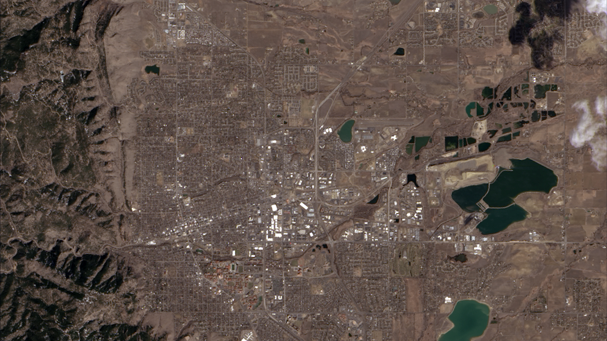

```{r}
#| eval: true
#| echo: false
#| out-width: "75%"
#| fig-align: "center"

```

::: {.gray-text .center-text}
The first image taken by Landsat 8 on March 18,2023,\n showing where the Great Plains and the Rocky Mountains meet in CO. 
:::

In this lab we'll work with our first remotely sensed dataset! We'll read the metadata file distributed alongside every Landsat scene to understand the image properties and extract the parameters needed for reflectance scaling, then create true and false color composite images.

## 1. Set up

```{r}
#| message: false
#| warning: false
library(terra)
library(tmap)
library(tidyverse)
library(kableExtra)
```

## 2. Data

We'll work with a **Landsat 8 OLI** image collected over **Santa Barbara, CA** on October 15, 2026. Landsat 8 is part of the longest-running Earth observation program, operated jointly by NASA and USGS since 1972.

### Downloading the data

We'll download data directly from [**USGS Earth Explorer**](https://earthexplorer.usgs.gov/), the primary portal for Landsat imagery.

**Step 1: Create a free USGS account**

Go to [earthexplorer.usgs.gov](https://earthexplorer.usgs.gov/) and click **Login → Create New Account**. You'll need to verify your email before you can download data.

**Step 2: Define your search area**

Navigate to the **Search Criteria** tab. In the **Address/Place** search box, type **Santa Barbara, CA** and click **Show**.

**Step 3: Select the California option (first row)**


**Step 4: Select a date range of 10/01/2026 to 11/01/2026**


**Step 5: Select Datasets**

Click Landsat > Landsat Collection 2 Level-2 > Landsat 8-9 OLI/TIRS C2 L2. Then click **Results**. 

**Step 6: Download**

After selecting the download arrow, click "Select Files" for the Level-2 Surface Reflectance Bands (13 files) option. Donwload the `.tif` files for bands  2-7, as well as the metadata (`MTL.xml`)

:::{.callout-warning icon=true}
# File sizes
You should have the following files: 

```
LC08_L2SP_042036_20261015_20261021_02_T1_SR_B2.TIF   ← Blue
LC08_L2SP_042036_20261015_20261021_02_T1_SR_B3.TIF   ← Green
LC08_L2SP_042036_20261015_20261021_02_T1_SR_B4.TIF   ← Red
LC08_L2SP_042036_20261015_20261021_02_T1_SR_B5.TIF   ← Near Infrared
LC08_L2SP_042036_20261015_20261021_02_T1_SR_B6.TIF   ← SWIR 1
LC08_L2SP_042036_20261015_20261021_02_T1_SR_B7.TIF   ← SWIR 2
LC08_L2SP_042036_20261015_20261021_02_T1_MTL.txt     ← Metadata
```

Where `LC08` = Landsat 8, `042036` = WRS-2 path/row, and the first date is the acquisition date.
:::

## 3. Metadata exploration

USGS distributes an `_MTL.txt` file alongside every Landsat scene. Open the file directly in a text editor and use the guide below to find key fields. You'll answer questions about what you find before moving on to the R analysis.

The MTL file is organized into named `GROUP` sections. The two most important for this lab are:

- **`IMAGE_ATTRIBUTES`** — when and where the image was collected, cloud cover, and sun geometry
- **`LEVEL2_SURFACE_REFLECTANCE_PARAMETERS`** — the scaling parameters needed to convert raw DN values to surface reflectance

### Metadata field guide

**`IMAGE_ATTRIBUTES`**

| Field | What it means |
|:------|:--------------|
| `SPACECRAFT_ID` | Which satellite collected the image |
| `SENSOR_ID` | Which sensor (`OLI_TIRS` = Operational Land Imager + Thermal Infrared Sensor) |
| `DATE_ACQUIRED` | Date the image was captured |
| `SCENE_CENTER_TIME` | Time of acquisition in UTC |
| `WRS_PATH` / `WRS_ROW` | WRS-2 grid location — the global addressing system for Landsat scenes. Path = descending orbit track, Row = latitude band |
| `CLOUD_COVER_LAND` | Percentage of the land area covered by clouds |
| `IMAGE_QUALITY_OLI` | Sensor quality score from 0 (worst) to 9 (best) |
| `SUN_ELEVATION` | Angle of the sun above the horizon at acquisition (degrees). Higher = summer/tropics, lower = winter/poles. Affects shadow length and overall image brightness |
| `SUN_AZIMUTH` | Compass direction of the sun at acquisition (degrees clockwise from north). Determines which side of objects shadows fall on |
| `EARTH_SUN_DISTANCE` | Distance from Earth to Sun in astronomical units (AU) at time of acquisition. Earth is closest (~0.983 AU) in early January and farthest (~1.017 AU) in early July |
| `SATURATION_BAND_X` | Whether any pixels in that band hit the sensor's maximum recordable value. `Y` = at least one pixel was brighter than the sensor could record. Its DN is clipped to 65535 (max value for 16 bit) regardless of the true reflectance, so the actual value is unknown. This typically happens over very bright surfaces (snow, clouds, sun glint on water). |

**`LEVEL2_SURFACE_REFLECTANCE_PARAMETERS`**

| Field | What it means |
|:------|:--------------|
| `REFLECTANCE_MULT_BAND_X` | Scale factor — multiply raw DN by this value |
| `REFLECTANCE_ADD_BAND_X` | Additive offset — add this after multiplying |
| `QUANTIZE_CAL_MAX/MIN_BAND_X` | Valid DN range (1–65535; a value of 0 means no data) |
| `REFLECTANCE_MAXIMUM/MINIMUM_BAND_X` | Valid reflectance range after scaling (slightly negative values can occur from atmospheric correction; values slightly above 1 are physically possible for some surfaces) |

**Band specifications** *(from [USGS Landsat sensor documentation](https://www.usgs.gov/landsat-missions/landsat-8), not the MTL file)*

| Band | Wavelength | Useful for |
|:-----|:-----------|:-----------|
| `Band 2 (blue)` | 0.45–0.51 µm | Water depth, coastal features, urban areas |
| `Band 3 (green)` | 0.53–0.59 µm | Vegetation health (chlorophyll), sediment in water |
| `Band 4 (red)` | 0.64–0.67 µm | Iron oxides in soil; healthy vegetation *absorbs* red |
| `Band 5 (NIR)` | 0.85–0.88 µm | Vegetation biomass; water *absorbs* NIR strongly |
| `Band 6 (SWIR1)` | 1.57–1.65 µm | Soil/vegetation moisture, fire detection |
| `Band 7 (SWIR2)` | 2.11–2.29 µm | Mineral mapping, burned area detection |


:::{.callout-warning icon=true}
# Questions

Open the `_MTL.txt` file in a text editor and use the guide above to answer the following:

1. Which satellite and sensor collected this image?
2. What date and time (UTC) was the image acquired?
3. The `EARTH_SUN_DISTANCE` is ~0.997 AU. Is Earth closer to or farther from the Sun than average on this date? What does this mean for the amount of incoming solar radiation?
4. Write out the complete scaling equation for Band 4 (Red) using the values you find in `LEVEL2_SURFACE_REFLECTANCE_PARAMETERS`.
5. What is the `CLOUD_COVER_LAND` percentage? Would you consider this scene suitable for analysis? What cloud cover threshold would you set when searching for usable Landsat scenes, and why?
6. Check `SATURATION_BAND_4` and `SATURATION_BAND_5`. If a band is marked `Y`, what does that mean for the pixel values in that band? How could saturation affect a spectral index like NDVI that uses both bands?


:::

### Loading the data

```{r}
data_dir <- here::here("course-materials/labs/data/landsat/")


band_files <- list.files(data_dir,
                         pattern = "\\.TIF$",
                         full.names = TRUE,
                         ignore.case = TRUE) |>
  sort()

landsat <- terra::rast(band_files)
names(landsat) <- c("blue", "green", "red", "NIR", "SWIR1", "SWIR2")

```


Now set the scaling parameters you found in the MTL file. We'll use these in Section 4.

```{r}
scale_factor <- 2.75e-05
add_offset   <- -0.2
```

### Raster properties

Printing the raster object gives a summary of the spatial properties. Compare what you see here to the four image resolutions from lecture.

```{r}
landsat
```

```{r}
# confirm data type — determines radiometric resolution
datatype(landsat)
```

:::{.callout-note icon=true}
# Connecting raster properties to image resolutions

| Resolution | What it describes | Where to find it |
|:-----------|:-----------------|:-----------------|
| **Spatial**    | Pixel size on the ground | Raster summary |
| **Spectral**   | Number of bands | Raster summary |
| **Radiometric** | Possible values per pixel | `datatype()` — `INT2U` = 16-bit = 65,536 levels |
| **Temporal**   | Revisit time | [Landsat Mission Info](https://www.usgs.gov/landsat-missions/landsat-8) |
:::

:::{.callout-note icon=true}
# Bit depth in Landsat Collection 2

Landsat Collection 2 Level-2 data is stored as **16-bit unsigned integers** (`INT2U`): 2^16 = **65,536 possible values** per pixel. This is higher radiometric resolution than older 8-bit Landsat products, allowing finer discrimination of subtle reflectance differences.
:::

### Visualizing individual bands

Each band responds to a different portion of the electromagnetic spectrum. Before combining bands into composites, let's visualize them individually as grayscale images where bright = high pixel value, dark = low pixel value.

```{r}
#| code-fold: true
#| message: false
#| fig-height: 6

plot(landsat, col = gray.colors(256))                                                                                 
```

:::{.callout-warning icon=true}
# Explore the bands

- In which bands does water appear darkest? Why?
- In which band does vegetation appear brightest? Why?
:::


## 4. Reflectance scaling

The downloaded TIF files contain **scaled integers**, not raw sensor output. Landsat Collection 2 Level-2 products are already atmospherically corrected to surface reflectance, but the values are stored as integers to reduce file size. To recover actual reflectance values (0–1), we apply the linear equation with the scale factor and additive offset values we found in the metadata:

$$\text{Reflectance} = \text{integer} \times \text{scale factor} + \text{additive offset}$$

```{r}
landsat_scaled <- (landsat * scale_factor) + add_offset
landsat_scaled <- clamp(landsat_scaled, lower = 0, upper = 1)

# verify: values should now be approximately 0–1
minmax(landsat_scaled)
```

## 5. True color imagery

A **true color composite** maps the red, green, and blue bands to the red, green, and blue display channels, approximating how the scene looks to the human eye.

| Display channel | Satellite band | Wavelength |
|:----------------|:---------------|:-----------|
| Red             | Band 4 (red)   | 0.64–0.67 µm |
| Green           | Band 3 (green) | 0.53–0.59 µm |
| Blue            | Band 2 (blue)  | 0.45–0.51 µm |

```{r}
tm_shape(landsat_scaled) +
  tm_rgb(col = tm_vars(c("red", "green", "blue"), multivariate = TRUE),
                            col.scale = tm_scale_rgb(max_color_value = 1)) +
  tm_title("True color composite") +
  tm_scalebar(position = c("left", "bottom"))
```

## 6. False color imagery

A **false color composite** assigns satellite bands beyond the visible spectrum (or in a non-standard order) to the display channels, letting us highlight features that are difficult to distinguish in true color.

### Vegetation false color (NIR, Red, Green)

Placing the **near infrared band** in the red channel makes healthy vegetation appear vivid red — useful for assessing vegetation extent and health.

| Display channel | Satellite band | Why |
|:----------------|:---------------|:----|
| Red             | Band 5 (NIR)   | Vegetation reflects strongly in NIR → appears red |
| Green           | Band 4 (Red)   | Soil reflects red → appears green |
| Blue            | Band 3 (Green) | Water reflects slightly in green → appears blue |

```{r}
tm_shape(landsat_scaled) +
  tm_rgb(col = tm_vars(c("NIR", "red", "green"), multivariate = TRUE),
         col.scale = tm_scale_rgb(max_color_value = 1)) +
  tm_title("False color: NIR–Red–Green") +
  tm_scalebar(position = c("left", "bottom"))
```

### SWIR false color (SWIR1, NIR, Green)

Placing the **shortwave infrared band** in the red channel highlights moisture. Water absorbs both SWIR and NIR strongly, so water bodies appear very dark.

| Display channel | Satellite band  | Why |
|:----------------|:----------------|:----|
| Red             | Band 6 (SWIR1)  | Dry/burned surfaces reflect strongly → bright |
| Green           | Band 5 (NIR)    | Vegetated areas reflect NIR → appears green |
| Blue            | Band 3 (Green)  | Water absorbs all three → very dark |

```{r}
tm_shape(landsat_scaled) +
  tm_rgb(col = tm_vars(c("SWIR1", "NIR", "green"), multivariate = TRUE),
         col.scale = tm_scale_rgb(max_color_value = 1)) +
  tm_title("False color: SWIR1–NIR–Green") +
  tm_scalebar(position = c("left", "bottom"))
```

### Comparing all three composites

```{r}
#| code-fold: true

map_true <- tm_shape(landsat_scaled) +
  tm_rgb(col = tm_vars(c("red", "green", "blue"), multivariate = TRUE),
         col.scale = tm_scale_rgb(max_color_value = 1)) +
  tm_title("True color")

map_nir <- tm_shape(landsat_scaled) +
  tm_rgb(col = tm_vars(c("NIR", "red", "green"), multivariate = TRUE),
         col.scale = tm_scale_rgb(max_color_value = 1)) +
  tm_title("NIR false color")

map_swir <- tm_shape(landsat_scaled) +
  tm_rgb(col = tm_vars(c("SWIR1", "NIR", "green"), multivariate = TRUE),
         col.scale = tm_scale_rgb(max_color_value = 1)) +
  tm_title("SWIR false color")

tmap_arrange(map_true, map_nir, map_swir, nrow = 1)
```

:::{.callout-warning icon=true}
# Interpret the composites

1. What land cover types are clearest in the true color image?
2. Where do you see evidence of vegetation in the NIR false color image? Does its brightness match the Band 5 (NIR) grayscale image?
3. How does the SWIR composite help distinguish open water from other dark features such as shadows or urban areas?
:::
