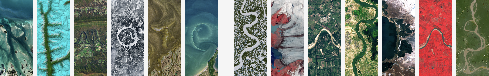

```{r}
#| eval: true
#| echo: false
#| out-width: "80%"
#| fig-align: "center"

```

::: {.gray-text .center-text}
[Your Name in Landsat](https://landsat.gsfc.nasa.gov/apps/YourNameInLandsat-main/index.html){target="_blank"}
:::

##  Class Materials

| Session                                                                         | Materials                                             |
|---------------------------------------------------------------------------------|-------------------------------------------------------|
|  Lecture | [Fundamentals of electromagnetic radiation](https://docs.google.com/presentation/d/1Y36oJ4uMazS2WFbmAIVnE2qDfp6ABBKgie6er54V_qg/edit?usp=sharing){target="_blank"}                  |
|  Raster Review                 | [Raster Review](labs/raster-review.qmd)        |
|  Lab                 | [Vector and raster interactions](labs/week5_v2.qmd)        |
|  Discussion               | [GIS Lab #2](https://docs.google.com/document/d/1LPXrNCx9m_Y-V0JYlXjX0WM7j6lgnloN/edit?usp=sharing&ouid=114976243173632226566&rtpof=true&sd=true) |

##  Assignment Reminders {#assignment-reminders}

:::{.callout-important icon=true}
## Important
All assignments are **due at 11:59 PM** on the date listed.
:::

| Assignment Type | Assignment Title                                         | Date Assigned | Date Due   |
|-----------------|----------------------------------------------------------|---------------|------------|
| SR             | [Self Reflection #2](../assignments/SR2.qmd){target="_blank"}                         | 10/27/2026    | 11/05/2026 |
| HW              | [Homework Assignment #3](../assignments/HW3.qmd){target="_blank"}            | 10/29/2026    | 11/07/2026 |


##  Background Reading

- [Remote Sensing of the Environment, Chapter 1](readings/Jensen-chapter1.pdf){target="_blank"}
- [Remote Sensing of the Environment, Chapter 2](readings/Jensen-chapter2.pdf){target="_blank"}

