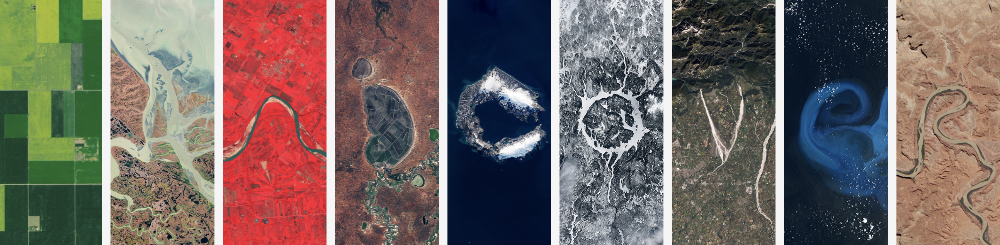

```{r}
#| eval: true
#| echo: false
#| out-width: "80%"
#| fig-align: "center"

```

::: {.gray-text .center-text}
[Your Name in Landsat](https://landsat.gsfc.nasa.gov/apps/YourNameInLandsat-main/index.html){target="_blank"}
:::

##  Class Materials

| Session                                                                         | Materials                                             |
|---------------------------------------------------------------------------------|-------------------------------------------------------|
|  Lab                 | [Remotely Sensed Rasters](labs/week7.qmd)        |
|  Lab materials to download                  | [Remotely Sensed Rasters](https://github.com/EDS-223-Geospatial/Weekly-Labs/tree/main/week7){target="_blank"} |
|  Discussion               | [GIS Lab #3](https://arcg.is/18bLOm3) |


##  Assignment Reminders {#assignment-reminders}

:::{.callout-important icon=true}
## Important
All assignments are **due at 11:59 PM** on the date listed.
:::

| Assignment Type | Assignment Title                              | Date Assigned | Date Due   |
|-----------------|-----------------------------------------------|---------------|------------|
| HW              | [Homework Assignment #4](../assignments/HW4.qmd){target="_blank"} | 11/12/2026    | 11/21/2026 |


